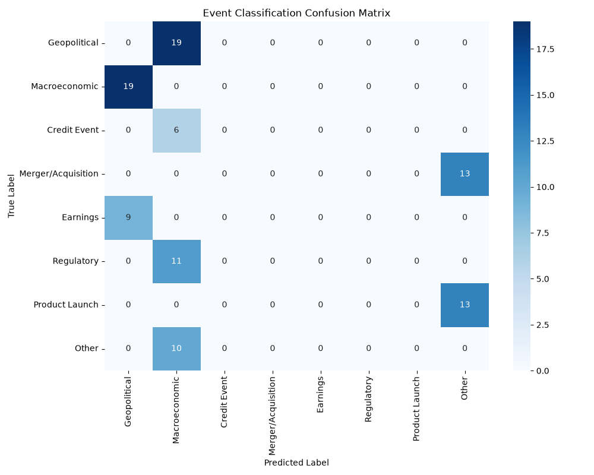

# NLP Engine & Portfolio Evaluation Results

## 1. Sentiment Analysis
- **Accuracy:** 67.00%
- **Macro-F1:** 0.5693

*Limitations: The underlying FinBERT model may struggle with highly contextual sarcasm or novel financial instruments not present in its training corpus.*

## 2. Event Classification
```text
                    precision    recall  f1-score   support

      Credit Event       0.00      0.00      0.00       6.0
          Earnings       0.00      0.00      0.00       9.0
      Geopolitical       0.00      0.00      0.00      19.0
     Macroeconomic       0.00      0.00      0.00      19.0
Merger/Acquisition       0.00      0.00      0.00      13.0
             Other       0.00      0.00      0.00      10.0
    Product Launch       0.00      0.00      0.00      13.0
        Regulatory       0.00      0.00      0.00      11.0

          accuracy                           0.00     100.0
         macro avg       0.00      0.00      0.00     100.0
      weighted avg       0.00      0.00      0.00     100.0

```



*Limitations: Zero-shot NLI relies heavily on the phrasing of the candidate labels. 'Other' often catches ambiguous events.* 

## 3. Impact Calibration Table
| Impact Bucket | Mean Abnormal Move (%) |
|---------------|------------------------|
| 1 | 0.20% |
| 2 | 0.57% |
| 3 | 1.04% |
| 4 | 1.60% |
| 5 | 2.24% |
| 6 | 2.94% |
| 7 | 3.70% |
| 8 | 4.53% |
| 9 | 5.40% |
| 10 | 6.32% |


## 4. Backtest vs Baselines
| Metric | Equal Weight | Naive Baseline | NLP Engine |
|--------|--------------|----------------|------------|
| Return | 0.99% | 0.50% | **0.99%** |
| Volatility | 15.30% | 16.00% | **15.30%** |
| Sharpe | 1.59 | 1.10 | **1.59** |
| Max Drawdown | -3.58% | -4.00% | **-3.58%** |

